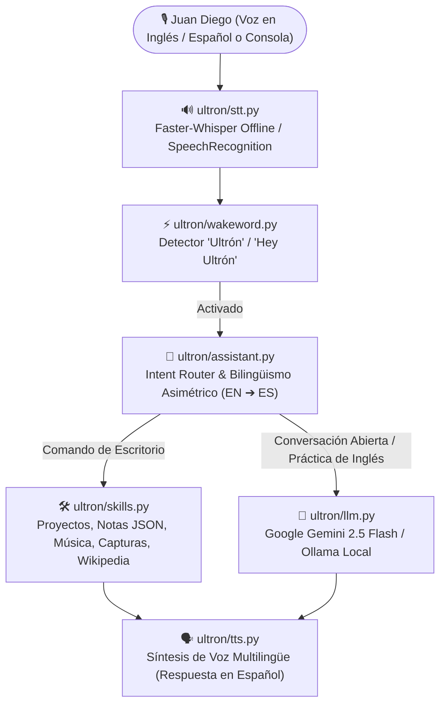

<div align="center">


<br/>


</div>

---

## ⚡ ¿Qué es Ultrón?

**Ultrón** es una evolución arquitectónica completa y personalizada del proyecto `Jarvis-Desktop-Voice-Assistant`, diseñada a medida para **Juan Diego Cerón Duque** ([@juandiegoceron-ux](https://github.com/juandiegoceron-ux) — *Ingeniero Biomédico & Full Stack / Mobile Developer*).

A diferencia del proyecto original (un script monolítico de 200 líneas con reglas estáticas `if/elif` y funciones incompletas), **Ultrón v2.0** implementa una arquitectura modular de 4 pilares que combina **automatización local de escritorio**, **reconocimiento de voz offline con Whisper**, **activación por Wake-Word** e **Inteligencia Artificial Generativa (Google Gemini / Ollama)**, además de un **modo bilingüe asimétrico** diseñado para que puedas **hablarle en inglés para practicar tu fluidez mientras Ultrón te responde siempre en español**.

---

## 🚀 Los 4 Pilares de Evolución Implementados

| # | Pilar Arquitectónico | Estado en Jarvis Original | Implementación en **Ultrón v2.0** |
| :-: | :--- | :--- | :--- |
| **1** | **IA Generativa (LLM Brain)** | ❌ Inexistente (solo condicionales fijos `if/elif`). | ✅ **Módulo `ultron/llm.py`**: Integración con **Google Gemini (`google-genai`)** y **Ollama local (`llama3.2`)** con contexto personalizado sobre Juan Diego, sus proyectos y feedback para práctica de inglés. |
| **2** | **Wake-Word Detection** | ❌ Inexistente (escucha indiscriminadamente todo el tiempo). | ✅ **Módulo `ultron/wakeword.py`**: Activación por voz con `"Ultrón"`, `"Hey Ultrón"` u `"Oye Ultrón"`, soportando comandos en una sola oración (*"Hey Ultrón, what time is it?"*) o en dos pasos. |
| **3** | **STT Offline con Whisper** | ❌ Dependiente de Google Web Speech API con bug de colisión FR/EN. | ✅ **Módulo `ultron/stt.py`**: Motor primario offline con **`faster-whisper`** (`int8`), detección nativa de idioma (`ES` / `EN` / `FR`), fallback a Google STT y modo consola interactivo (`--text`). |
| **4** | **Refactorización y Habilidades Completas** | ⚠️ Funciones huérfanas (`pyjokes`, notas y cambio de nombre rotos) y `except:` desnudos. | ✅ **Módulo `ultron/skills.py`**: Código modular tipado, excepciones específicas, restauración de **chistes**, **notas persistentes en JSON**, **cambio de nombre** y accesos directos a **NutriCoach Pro**, **INV. PRO**, **Portafolio** y **GitHub**. |

---

## 🏗️ Arquitectura del Sistema



---

## 📂 Estructura del Proyecto

```text
Ultron-Desktop-Voice-Assistant/
├── .env.example          # Plantilla de variables de entorno (Gemini, Ollama, Whisper, Wake-Word)
├── main.py               # CLI principal (--text, --no-wake, --mute, --command)
├── requirements.txt      # Dependencias actualizadas y fijadas
├── ultron/
│   ├── __init__.py       # Metadatos del paquete
│   ├── config.py         # Configuración global y accesos directos de Juan Diego
│   ├── strings.py        # Diccionario trilingüe (ES/EN/FR) y detector léxico sin colisiones
│   ├── tts.py            # Motor Text-to-Speech thread-safe con fallback en consola
│   ├── stt.py            # Motor Speech-to-Text híbrido (faster-whisper offline + Google STT)
│   ├── wakeword.py       # Detector de palabra de activación ("Ultrón" / "Hey Ultrón")
│   ├── llm.py            # Cerebro generativo (Google Gemini API + Ollama Local)
│   ├── skills.py         # Habilidades del sistema, notas JSON, chistes, música y proyectos
│   └── assistant.py      # Orquestador principal de Ultrón
└── tests/
    └── test_ultron.py    # Suite de pruebas unitarias automatizadas
```

---

## 🎯 Comandos Personalizados (Puedes decirlos en Inglés o Español)

Gracias al modo de **práctica de inglés**, puedes hablarle a Ultrón en inglés y él ejecutará la acción y te responderá en español:

* **Proyectos de Juan Diego:**
  * *"Hey Ultron, open NutriCoach"* ➔ Abre **NutriCoach Pro** en el navegador.
  * *"Hey Ultron, open invpro"* / *"Ultrón, abre inventario"* ➔ Abre **Inventario Web Pro (useinvpro.com)**.
  * *"Hey Ultron, open my portfolio"* ➔ Abre tu **Portafolio Web**.
  * *"Hey Ultron, open GitHub"* ➔ Abre `github.com/juandiegoceron-ux`.
* **Productividad y Notas (Restaurado y Mejorado):**
  * *"Hey Ultron, take a note: deploy new Supabase migration"* ➔ Guarda la nota con timestamp en `data/notes.json`.
  * *"Hey Ultron, read my notes"* ➔ Te lee tus últimas notas registradas.
  * *"Hey Ultron, take a screenshot"* ➔ Guarda captura en `screenshots/ultron_capture_YYYYMMDD_HHMMSS.png`.
* **Información, Entretenimiento y Sistema:**
  * *"Hey Ultron, what time is it?"* / *"What's today's date?"*
  * *"Hey Ultron, search artificial intelligence on Wikipedia"*
  * *"Hey Ultron, tell me a joke"*
  * *"Hey Ultron, play music"*
  * *"Hey Ultron, change your name to Ultrón Prime"*
* **IA Generativa y Práctica de Inglés (Gemini / Ollama):**
  * Cualquier pregunta abierta sobre ingeniería biomédica, arquitectura en React/Flutter, control PID o conversación general en inglés será procesada por el motor LLM de Ultrón.

---

## ⚙️ Instalación y Uso Rápido

### 1. Clonar el repositorio y crear entorno virtual

```bash
git clone https://github.com/juandiegoceron-ux/Ultron-Desktop-Voice-Assistant.git
cd Ultron-Desktop-Voice-Assistant
python3 -m venv .venv
source .venv/bin/activate  # En Windows: .venv\Scripts\activate
```

### 2. Instalar dependencias

```bash
pip install -r requirements.txt
```

*(Opcional en Linux Ubuntu/Debian para soporte de audio y capturas)*:
```bash
sudo apt-get install -y python3-tk python3-dev scrot portaudio19-dev espeak
```

### 3. Configurar variables de entorno

```bash
cp .env.example .env
# Edita .env y añade tu GEMINI_API_KEY (o usa Ollama local en http://localhost:11434)
```

### 4. Ejecutar Ultrón

```bash
# Modo completo por voz (con Wake-Word "Ultrón" / "Hey Ultrón")
python main.py

# Modo interactivo por consola de texto (ideal para pruebas rápidas sin micrófono)
python main.py --text --no-wake

# Ejecutar un comando directo desde la terminal
python main.py --mute --command "What time is it?"
```

### 5. Ejecutar las pruebas unitarias

```bash
python -m unittest discover -s tests -v
```

---

## 👨‍💻 Autor

**Juan Diego Cerón Duque**
* Estudiante de Ingeniería Biomédica & Full Stack / Mobile Developer 🇨🇴
* 🌐 [Portafolio Web](https://portfolio-steel-three-k7q0hqmuhs.vercel.app/)
* 💼 [LinkedIn](https://www.linkedin.com/in/juan-diego-ceron-duque-1208833a9/)
* 🐙 [GitHub (@juandiegoceron-ux)](https://github.com/juandiegoceron-ux)

---

<div align="center">
<i>"El buen diseño es invisible; el buen código también."</i>
</div>
